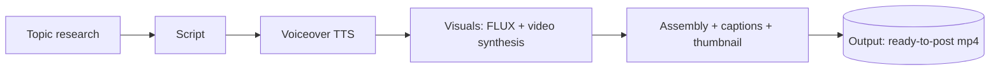

# Content engine

Unattended content production pipeline for faceless social channels. Generates videos end to end: topic research, script, voiceover, visuals, assembly. Runs daily on a schedule with zero human input.

## Why

Individual creators produce one video per day if they're motivated. The bottleneck is never one step, it's the chain: finding a topic, writing, recording, editing, exporting. Each handoff loses a day. This pipeline removes the handoffs. The machine does the whole chain, and a human QA pass exists where it matters (before publishing, not between every step).

## Channels

Multiple channels run off the same engine, each with its own niche, voice, and visual identity:

- **Tao AI**: spirituality / inner peace influencer persona
- **AI affiliate**: AI tool reviews with affiliate links
- **Faceless food**: recipe content
- **Zen**: calming ambient visuals

## Pipeline

- **Research** finds trending topics per niche and avoids repeats from the channel's own history
- **Script** generation from per-vertical templates, with hook variants for A/B testing
- **Voiceover** via local TTS with per-channel voice selection
- **Visuals** from local FLUX image generation (4070 Ti) and video synthesis, with a programmatic gradient fallback so the pipeline never hard-fails on a visual step
- **Assembly** burns captions, picks the thumbnail, and writes the final file

## Operating for real

This is not a demo pipeline. It runs daily via cron:

- 10 videos/day across channels, unattended
- GPU lock so the video pipeline and other GPU jobs don't collide
- Checkpoint/resume: a failed run picks up where it stopped instead of redoing everything
- Consolidated report after each run: per-channel counts, errors, duration
- Typical full run: 30-90 minutes. With warm caches: about a minute.

## Stack

Python, FLUX (local ComfyUI), TTS (local Voicebox, edge-tts fallback), cron orchestration, YAML channel config. Everything runs on one workstation with a consumer GPU. Marginal cost per video: effectively zero.

## Adding a channel

Three steps: add an entry to `config/channels.yaml`, create the channel directory with its templates and assets, run the pipeline for it. The engine handles research-to-output without channel-specific code.

---

*Showcase repo: architecture and operations. Pipeline source and channel assets stay private.*
